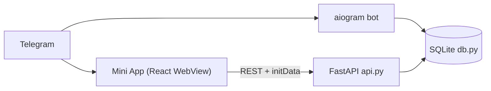

### Задача: 
Cоздать систему, позволяющую выучить иностранные слова с использованием метода "карточек"

### Система должна содержать:
- Пользовательский интерфейс в виде ТГ бота.
- Сервер.
- Базу данных. В БД должны храниться базовые коллекции карточек по различным темам.

### Система должна обеспечивать:
- Регистрацию и авторизацию пользователей.
- Добавление / удаление собственных карточек, категорий.
- Вывод карточки пользователю с вариантами перевода, причем как с английского  на русский, так и наоборот.
- Ведение статистики (верных ответов), (времени использования) для каждого пользователя.
- Выбор класса карточек из общедоступных и собственных категорий.

## Telegram Mini App (WebApp)

Приложение доработано до формата **Telegram Mini App**: помимо чат-сценариев
(карточки/диалог кнопками) появился полноценный интерфейс в WebView —
флеш-карточки с переворотом, оценкой «Забыл/Плохо/Помню/Отлично» (интервальные
повторения, лейтмотив UX-схемы выше), словарь с добавлением/удалением слов и статистика.

### Структура
```
main.py            # aiogram-бот (кнопка WebApp, /app, команды)
api.py             # FastAPI HTTP API для Mini App (та же БД, auth через initData)
db.py              # aiosqlite: words / user_words / users + stats, forget_word, grade
keyboards.py       # inline-клавиатуры (web_app кнопка)
scheduler.py       # напоминания
webapp/            # React + TypeScript + Vite фронтенд Mini App (@telegram-apps/sdk)
```

### Архитектура



### Запуск (dev)
```bash
# 1. API
uvicorn api:app --reload --port 8000
# 2. Фронт (http://localhost:5173, работает и вне Telegram с dev-initData)
cd webapp && npm install && npm run dev
# 3. Прод-сборка фронтенда
cd webapp && npm run build   # -> webapp/dist (раздать по HTTPS)
```

### Подключение к боту
1. Хостинг `webapp/dist` по **HTTPS** (требование Telegram).
2. @BotFather → `/newapp` (или Bot Settings → Menu Button) → указать URL.
3. В `.env`: `MINI_APP_URL=https://your.domain/`, `BOT_SECRET_KEY=<из BotFather>`
   (нужен для HMAC-проверки initData в `api.py`; без него dev-режим).
4. Бот сам добавит кнопку «📱 Карточки (Mini App)» в меню и команду `/app`.

### API
| Метод | Путь               | Описание                                   |
|-------|--------------------|--------------------------------------------|
| GET   | `/api/state`       | due-карточки, словарь, статистика          |
| POST  | `/api/review`      | `{word_id, grade 1..4}` — интервальное повторение |
| POST  | `/api/word`        | `{en, ru, kind}` — добавить слово          |
| DELETE| `/api/word/{id}`   | удалить слово из списка пользователя       |

Авторизация: заголовок `X-Init-Data` (подписанный Telegram `initData`), проверка HMAC-SHA256 по схеме [core.telegram.org/bots/webapps](https://core.telegram.org/bots/webapps#validating-data-received-via-the-mini-app).

### Технологии:
- Python / Aiogram для реализации ТГ бота.
- Java / Tomcat / Spring / Maven / Docker / Kubernetes / Apache Kafka / ELK, Grafana для реализации сервера.
- JUnit для тестирования.
- PostgreSQL / Hibernate.
- CI/CD для непрерывного развертывания.

### Общая диаграмма

```mehrmaid
flowchart LR
	Telegram["Telegram"]
    Bot["Bot"]
    Server["Server"]
    DataBase["DataBase"]

    Telegram --> Bot --> Server --> DataBase
    DataBase --> Server --> Bot --> Telegram
```


## Telegram-бот для запоминания английских слов методом карточек 

### UX-схема диалогов (flow)

/start
│
├── ➕ Добавить слово
│   ├── Введите слово → 
│   ├── Введите перевод → 
│   └── Пример (опционально) → ✅ Сохранено
│
├── 🔁 Повторить
│   ├── [Показ: front + example]
│   │   ├── ❌ Забыл → карточка → завтра
│   │   ├── 😕 Плохо → карточка → через 1–2 дня
│   │   ├── 🙂 Помню → карточка → через N дней × EF
│   │   └── ✅ Отлично → карточка → через N*EF
│   └── (цикл, пока не кончатся карточки)
│
├── 📊 Статистика
│   └── Всего: 42  
│       Сегодня повторить: 8  
│       Новых за неделю: 15  
│
└── ⚙️ Настройки (опционально позже)
    ├── Частота напоминаний: [Утро ☀️] [Вечер 🌙]
    └── Тема: [Светлая] [Тёмная]
