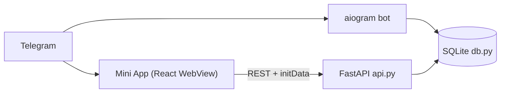
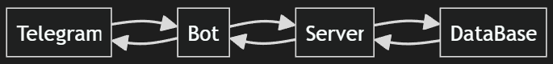

### Задача: 
Cоздать систему, позволяющую выучить иностранные слова с использованием метода "карточек"

### Система должна содержать:
- Пользовательский интерфейс в виде ТГ бота.
- Сервер.
- Базу данных. В БД должны храниться базовые коллекции карточек по различным темам.

### Система должна обеспечивать:
- Регистрацию и авторизацию пользователей.
- Добавление / удаление собственных карточек, категорий.
- Вывод карточки пользователю с вариантами перевода, причем как с английского  на русский, так и наоборот.
- Ведение статистики (верных ответов), (времени использования) для каждого пользователя.
- Выбор класса карточек из общедоступных и собственных категорий.

## Telegram Mini App (WebApp)

Приложение доработано до формата **Telegram Mini App**: помимо чат-сценариев
(карточки/диалог кнопками) появился полноценный интерфейс в WebView —
флеш-карточки с переворотом, оценкой «Забыл/Плохо/Помню/Отлично» (интервальные
повторения, лейтмотив UX-схемы выше), словарь с добавлением/удалением слов и статистика.

### Структура
```
main.py            # aiogram-бот (кнопка WebApp, /app, команды)
api.py             # FastAPI HTTP API для Mini App (та же БД, auth через initData)
db.py              # aiosqlite: words / user_words / users + stats, forget_word, grade
keyboards.py       # inline-клавиатуры (web_app кнопка)
scheduler.py       # напоминания
webapp/            # React + TypeScript + Vite фронтенд Mini App (@telegram-apps/sdk)
```

### Архитектура



### Запуск (dev)
```bash
# 1. API
uvicorn api:app --reload --port 8000
# 2. Фронт (http://localhost:5173, работает и вне Telegram с dev-initData)
cd webapp && npm install && npm run dev
# 3. Прод-сборка фронтенда
cd webapp && npm run build   # -> webapp/dist (раздать по HTTPS)
```

### Подключение к боту
1. Хостинг `webapp/dist` по **HTTPS** (требование Telegram). См. подробный разбор ниже.
2. @BotFather → `/newapp` (или Bot Settings → Menu Button) → указать URL.
3. В `.env`: `MINI_APP_URL=https://your.domain/`, `BOT_SECRET_KEY=<из BotFather>`
   (нужен для HMAC-проверки initData в `api.py`; без него dev-режим).
4. Бот сам добавит кнопку «📱 Карточки (Mini App)» в меню и команду `/app`.

### Что значит «раздать webapp/dist по HTTPS»

`npm run build` компилирует React-приложение в статические файлы
(`webapp/dist/index.html` + `assets/*.js|css`). Их нужно выложить на веб-сервер,
чтобы Telegram мог открыть их по публичному **https://** адресу внутри WebView.
Telegram принципиально не открывает Mini App по `http://` или `localhost` —
поэтому нужен сервер с SSL-сертификатом и доменом. Варианты, от простого к продакшену:

**A. Локальный тест за 1 минуту (cloudflared, без своего сервера)**
```bash
cd webapp && npm run build
python -m http.server --directory dist 8000     # локальная раздача статики
cloudflared tunnel --url http://localhost:8000  # выдаст https://xxxx.trycloudflare.com
# этот https-URL указываете в BotFather; API при этом должен быть доступен там же
```

**B. Один VPS: FastAPI раздаёт и фронт, и API (уже настроено в `api.py`)**
`api.py` монтирует `webapp/dist` как статику, поэтому достаточно одного процесса:
```bash
cd webapp && npm run build          # обновить dist
uvicorn api:app --host 127.0.0.1 --port 8000
```
Перед ним ставится Nginx с TLS — готовый конфиг: `deploy/nginx-wordcards.conf`
```bash
sudo apt install nginx certbot python3-certbot-nginx
sudo cp deploy/nginx-wordcards.conf /etc/nginx/sites-available/wordcards  # + заменить домен
sudo ln -s /etc/nginx/sites-available/wordcards /etc/nginx/sites-enabled/
sudo certbot --nginx -d your.domain.com    # бесплатный сертификат Let's Encrypt
sudo systemctl reload nginx
```
Итого: `https://your.domain.com/` → карточки, `https://your.domain.com/api/*` → REST.
Фронтенд ходит в API по относительному пути (тот же origin), CORS не мешает.

**C. Статический хостинг фронта + API отдельно**
Загрузить содержимое `webapp/dist` на Netlify / Vercel / GitHub Pages — они дают
HTTPS из коробки. Тогда в `webapp/src/telegram.ts` укажите `API_BASE` на ваш
бэкенд и разрешите его origin в CORS в `api.py`.

После любого варианта: BotFather → Your bot → Bot Settings → Menu Button →
`https://your.domain.com/` — и кнопка «Открыть приложение» появится в чате.

### Запуск на Windows (PowerShell)

**1. Установка зависимостей (один раз)**
```powershell
# Python 3.10+ с python.org (при установке отметить "Add python.exe to PATH")
py -m venv .venv
.\.venv\Scripts\Activate.ps1        # если скрипты заблокированы:
# Set-ExecutionPolicy -Scope CurrentUser RemoteSigned
pip install -r requirements.txt

# Node.js LTS с nodejs.org (даёт npm)
cd webapp
npm install
cd ..
```

**2. Настройка `.env`** (в корне проекта, рядом с main.py):
```
TOKEN=123456:AAA...                  # токен бота из @BotFather
BOT_SECRET_KEY=...                   # BotFather → /webapps → Secret Key (можно пустым для dev)
MINI_APP_URL=https://xxxx.trycloudflare.com
```

**3. Сборка фронтенда**
```powershell
cd webapp
npm run build                        # -> webapp/dist
cd ..
```

**4. Быстрый способ (туннель cloudflared — HTTPS без сервера)**
```powershell
# Скачать cloudflared-windows-amd64.exe с https://github.com/cloudflare/cloudflared/releases
# и положить, например, в C:\tools\cloudflared.exe (или добавить папку в PATH)

# Терминал 1 — API + фронт одним процессом (api.py сам раздаёт webapp/dist):
.\.venv\Scripts\Activate.ps1
uvicorn api:app --host 127.0.0.1 --port 8000

# Терминал 2 — туннель:
C:\tools\cloudflared.exe tunnel --url http://localhost:8000
# в логе появится https://xxxx-random-words.trycloudflare.com — это и есть ваш HTTPS-URL
```
Этот URL укажите в BotFather (Menu Button → Set Web App URL) и в `.env` (`MINI_APP_URL`),
после чего перезапустите бота: `python main.py`.

**5. Продакшен-вариант на Windows без Linux**
Вместо Nginx/certbot можно взять любой PaaS с TLS из коробки:
- FastAPI деплоится на **Railway / Render / Fly.io** (там же будет раздаваться `webapp/dist`, см. п.B);
- либо вариант C: `webapp/dist` на Netlify/Vercel (drag-and-drop в браузере), API — отдельно.

**Полезные команды для разработки на Windows**
```powershell
# Фронт с hot-reload вне Telegram (dev-initData): http://localhost:5173
cd webapp; npm run dev

# Проверить, что API отвечает
Invoke-RestMethod http://localhost:8000/api/state -Headers @{ "X-Init-Data" = "query_id=test&user=%7B%22id%22%3A1%7D&auth_date=1&hash=" }

# Если uvicorn не найден после активации venv:
py -m uvicorn api:app --reload --port 8000
```

Примечания:
- SQLite (`bot.db`) работает на Windows без доп. настроек.
- В dev-режиме (пустой `BOT_SECRET_KEY`) подпись initData не проверяется — удобно тестировать фронт через `npm run dev`.
- trycloudflare-URL меняется при каждом запуске cloudflared — после смены не забудьте обновить его в BotFather.

### API
| Метод | Путь               | Описание                                   |
|-------|--------------------|--------------------------------------------|
| GET   | `/api/state`       | due-карточки, словарь, статистика          |
| POST  | `/api/review`      | `{word_id, grade 1..4}` — интервальное повторение |
| POST  | `/api/word`        | `{en, ru, kind}` — добавить слово          |
| DELETE| `/api/word/{id}`   | удалить слово из списка пользователя       |

Авторизация: заголовок `X-Init-Data` (подписанный Telegram `initData`), проверка HMAC-SHA256 по схеме [core.telegram.org/bots/webapps](https://core.telegram.org/bots/webapps#validating-data-received-via-the-mini-app).

### Технологии:
- Python / Aiogram для реализации ТГ бота.
- Java / Tomcat / Spring / Maven / Docker / Kubernetes / Apache Kafka / ELK, Grafana для реализации сервера.
- JUnit для тестирования.
- PostgreSQL / Hibernate.
- CI/CD для непрерывного развертывания.

### Общая диаграмма

```mehrmaid
flowchart LR
	Telegram["Telegram"]
    Bot["Bot"]
    Server["Server"]
    DataBase["DataBase"]

    Telegram --> Bot --> Server --> DataBase
    DataBase --> Server --> Bot --> Telegram
```




## Telegram-бот для запоминания английских слов методом карточек 

### UX-схема диалогов (flow)

/start
│
├── ➕ Добавить слово
│   ├── Введите слово → 
│   ├── Введите перевод → 
│   └── Пример (опционально) → ✅ Сохранено
│
├── 🔁 Повторить
│   ├── [Показ: front + example]
│   │   ├── ❌ Забыл → карточка → завтра
│   │   ├── 😕 Плохо → карточка → через 1–2 дня
│   │   ├── 🙂 Помню → карточка → через N дней × EF
│   │   └── ✅ Отлично → карточка → через N*EF
│   └── (цикл, пока не кончатся карточки)
│
├── 📊 Статистика
│   └── Всего: 42  
│       Сегодня повторить: 8  
│       Новых за неделю: 15  
│
└── ⚙️ Настройки (опционально позже)
    ├── Частота напоминаний: [Утро ☀️] [Вечер 🌙]
    └── Тема: [Светлая] [Тёмная]
